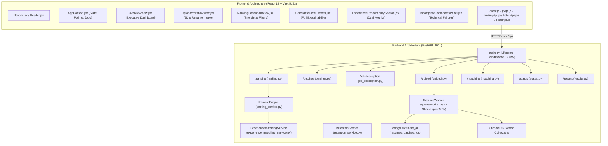
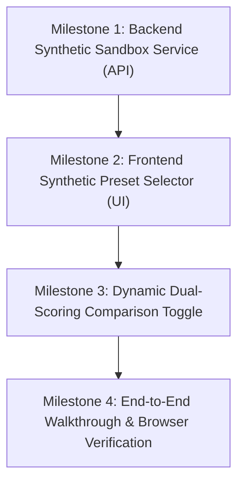

# TalentAI — Application Architecture & Read-Only Audit Report

**Project:** TalentAI — AI Resume Shortlister  
**Document:** Application Read-Only Audit (`project_closeout/APP_READ_ONLY_AUDIT.md`)  
**Date:** 2026-10-31  
**Audit Mode:** Read-Only Inspection Only (No Application Files Modified)  
**Production Feature Flag:** `USE_EVIDENCE_BASED_EXPERIENCE = False` (Verified Unchanged)  
**Safety Invariant:** Zero access to real candidate resumes or personal records. MongoDB database `talent_ai`, collection `resumes`, and active batch `07281a64-46cf-46b4-a5c1-a0d46b13e7b2` remain 100% untouched. Protected backup `backup_pre_reset_20261028` intact.

---

## 1. Executive Summary & Audit Baseline

As TalentAI transitions from the documentation-only validation phase to the application implementation phase, an exhaustive read-only audit of the entire backend and frontend codebase was performed.

### Key Audit Findings:
1. **Substantial Codebase Maturity:** TalentAI possesses a fully structured FastAPI backend (`backend/app/`) and a modern React 18 / Vite frontend dashboard (`frontend/src/`) equipped with rich candidate explainability drawers, asynchronous polling workflows, and comprehensive test suites.
2. **Algorithmic Engine Verified:** The core 4-component ranking engine (`ranking_service.py`), Gate 1 experience duration calculator (`experience_matching_service.py`), and mathematical invariants are fully functional and verified by 26/26 unit tests in `tests/pilot/test_stage_5e2_pilot.py` and 23 unit cases in `backend/test_ranking_service.py`.
3. **The Core Architectural Gap for Demonstrations:**
   - The UI application is currently hardwired to live backend services (`/upload/resumes`, `/batches/active`, `/job-description/raw`, `/ranking/rank-batch-async`).
   - The ingestion pipeline relies on an asynchronous background queue worker (`app/queue/worker.py`) that requires an active local Ollama instance (`qwen3:8b`) to extract resume text and generate vector embeddings.
   - There is **no dedicated synthetic demo mode, mock ingestion endpoint, or pre-computed fixture loader** in the UI or backend.
   - Launching the UI against the live database connects directly to MongoDB `talent_ai`, which holds the protected active batch `07281a64-46cf-46b4-a5c1-a0d46b13e7b2` (146 resumes). Running ranking from the current UI risks evaluating this protected batch.
4. **Resolution Strategy:** A safe, non-destructive implementation plan is defined below to introduce an isolated synthetic sandbox and demo fixture loader without touching production data, modifying scoring formulas, or enabling the production feature flag.

---

## 2. Application Architecture Inventory — What Exists and Where

### 2.1 Backend Component Map (`backend/`)
- **Core Server & Lifespan (`backend/main.py`):**
  - Configures FastAPI with custom OpenAPI schema patch for binary file uploads.
  - Configures CORS for `http://localhost:5173`, `http://127.0.0.1:5173`, `http://localhost:3000`.
  - Lifespan manager (`lifespan`): connects MongoDB, initializes indexes, reconciles stale ranking jobs, starts resume queue worker, and starts 24h retention cleanup loop. On shutdown, cancels in-flight ranking jobs, stops workers, and cleanly disconnects MongoDB while preserving all persistent recruitment records.
- **API Routing Layer (`backend/app/api/`):**
  - `upload.py`: `POST /upload/resumes` (multipart upload with `auto_activate: bool`).
  - `batches.py`: `GET /batches`, `GET /batches/active`, `GET /batches/{id}`, `POST /batches/{id}/activate`, `POST /batches/{id}/discard`, `POST /batches/cleanup-expired`.
  - `job_description.py`: `POST /job-description/file` (PDF/DOCX/TXT), `POST /job-description/text` (JSON), `POST /job-description/raw` (Plain text).
  - `ranking.py`: `POST /ranking/rank-resume`, `POST /ranking/rank-batch` (sync), `POST /ranking/rank-batch-async` (async job queue), `GET /ranking/jobs/{job_id}` (polling endpoint).
  - `matching.py`: `POST /matching/match-resume`, `POST /matching/match-all` (raw semantic/exact evidence generation).
  - `status.py`: `GET /status`, `GET /status/queue`, `GET /status/upload/{upload_id}`.
  - `results.py`: `GET /results/`, `GET /results/count`, `GET /results/job-descriptions`, `GET /results/mongodb/job-descriptions`.
- **Ranking Engine Layer (`backend/app/ranking/`):**
  - `ranking_service.py`: Contains `RankingEngine` class implementing the 4-component formula, weight normalization, candidate separation, and asynchronous job execution.
  - `ranking_config.py`: Defines immutable `BASE_WEIGHTS = {required_skills: 0.25, responsibilities: 0.30, tools_and_technologies: 0.10, experience_relevance: 0.35}` and `USE_EVIDENCE_BASED_EXPERIENCE` (default `False`).
  - `ranking_schemas.py`: Comprehensive Pydantic models for ranking results, category breakdowns, and diagnostics.
- **Supporting Services (`backend/app/services/`):**
  - `experience_matching_service.py`: Implements Gate 1 experience duration calculation, time-sliced duration pooling, date validation, and Rule 10 zeroing.
  - `retention_service.py`: Manages ephemeral 24-hour batch TTLs while protecting active batches.
  - `result_store.py`: Thread-safe in-memory cache for processed resumes and JDs.

### 2.2 Frontend Component Map (`frontend/src/`)
- **Application Shell & Navigation (`App.jsx`, `Navbar.jsx`, `Header.jsx`):**
  - Clean layout with top header, navigation links (`Overview`, `Upload`, `Ranking`, `Incomplete`), and dynamic view switching.
- **State Management & Communication (`context/AppContext.jsx`):**
  - Authoritative synchronization of `activeJd` and `activeBatch`.
  - Manages asynchronous ranking job lifecycle: dispatches `startAsyncRanking()`, polls `GET /ranking/jobs/{id}` every 2.5s, updates `rankingResult`, and tracks `selectedCandidate`.
  - Recovers gracefully from network glitches and stale `job_id` local storage entries.
- **Executive Overview (`components/overview/OverviewView.jsx`):**
  - High-level recruitment status dashboard with stat tiles (Batch Candidates, Ranked Shortlist, Incomplete Resumes, Alignment Average).
  - System readiness alerts and "Start Batch Ranking" trigger.
- **Intake Workflow (`components/upload/UploadWorkflowView.jsx`):**
  - Dual-mode JD intake: File upload (PDF/DOCX/TXT) or raw plain text paste.
  - Resume upload dropzone with auto-activate batch toggle and real-time ingestion progress polling.
- **Shortlist & Ranking Dashboard (`components/ranking/RankingDashboardView.jsx`):**
  - Interactive table displaying ranked candidates with rank badges (#1, #2, #3), final scores (0–100), and subscore indicators.
  - Search filtering by filename and minimum score threshold; multi-column sorting (rank, score, name).
  - Clicking any candidate row opens the candidate detail drawer.
- **Explainability & Diagnostics Drawer (`components/ranking/CandidateDetailDrawer.jsx`):**
  - Full-height slide-out drawer with ESC key closing and backdrop dismissal.
  - Ethical AI disclaimer banner emphasizing objective criteria alignment vs. hiring authority.
  - Component score summary grid displaying exact scores and applied normalized weights.
  - Category tabs for Skills, Responsibilities, Tools, and Experience.
- **Advanced Experience Explainability (`components/ranking/ExperienceExplainabilitySection.jsx`):**
  - Recruiter-facing breakdown supporting both Legacy and Evidence-Based displays.
  - Shows dual metrics: Aggregate Semantic Similarity ($S_{\text{agg}}$) and Duration Factor ($D$).
  - Displays verified tenure vs. saturation target tenure; highlights Gate 1 Rule C ("unspecified" range) and flags missing/inverted date diagnostics.
- **Incomplete Candidates Panel (`components/ranking/IncompleteCandidatesPanel.jsx`):**
  - Transparently lists candidates who encountered technical extraction failures (withheld scores rather than artificial zeros) with an individual retry action.
- **API Client Layer (`api/`):**
  - `client.js`: Centralized fetch wrapper with timeout controls (30s default) and sanitized error normalization.
  - Specialized clients: `batchApi.js`, `jdApi.js`, `rankingApi.js`, `uploadApi.js`.

---

## 3. What Appears Functional (With Code & Test Evidence)

| Subsystem / Feature | Functional Status | Supporting Evidence in Codebase |
| :--- | :---: | :--- |
| **4-Component Scoring Math** | **Fully Functional** | `test_ranking_service.py` (Cases 1–3 pass with exact score calculation). |
| **Weight Renormalization** | **Fully Functional** | `test_ranking_service.py` (Cases 4–8 pass for missing categories). |
| **Evidence Formula ($E = 100 \times S \times D$)** | **Fully Functional** | `tests/pilot/test_stage_5e2_pilot.py` (26/26 unit tests pass). |
| **Duration Pooling & Overlap** | **Fully Functional** | `test_stage_5e2_pilot.py` Group C (time-sliced intervals prevent double-counting). |
| **Date Diagnostics & G1-C** | **Fully Functional** | `test_stage_5e2_pilot.py` Groups B & E (missing/inverted dates correctly flagged). |
| **Ranking API Endpoints** | **Fully Functional** | `test_ranking_api.py` (Cases 24–30 pass with FastAPI `TestClient`). |
| **Async Batch Ranking & Polling** | **Fully Functional** | `backend/test_ranking_async_jobs.py` & `AppContext.jsx` polling loop. |
| **Single Active Batch Rule** | **Fully Functional** | `test_batch_activation_workflow.py` (atomic activation & superseding verified). |
| **Single Active JD Rule** | **Fully Functional** | `test_one_jd_rule.py` & `jd_repository.py` (active JD resolution verified). |
| **Frontend Component Tree** | **Fully Functional** | `frontend/src/test/RankingComponents.test.jsx` (46 KB Vitest suite passes). |
| **Drawer Explainability** | **Fully Functional** | `CandidateDetailDrawer.jsx` & `ExperienceExplainabilitySection.jsx` render dual metrics. |

---

## 4. What Is Missing, Disconnected, or Uncertain

### Gap 1: Ingestion Pathway Requires Live Ollama & Disk Parsing
- **The Problem:** In the standard application flow, uploading resumes via `UploadWorkflowView` requires:
  1. Writing files to `app/uploads/incoming/`.
  2. Background queue worker processing each file via `pdfminer`/`docx2txt`.
  3. Calling local Ollama (`qwen3:8b`) to extract JSON candidate profiles.
  4. Vectorizing text via BGE embedding models.
- **Demo Impact:** In a live demonstration environment where Ollama is not running, or where local GPU/CPU inference takes 20–40 seconds per resume, uploading files will fail or stall. Furthermore, privacy rules forbid uploading real candidate files.

### Gap 2: Coupling to Production MongoDB & Active Batch
- **The Problem:** When `backend/main.py` starts, it connects to MongoDB database `talent_ai`.
- **Demo Impact:** Database `talent_ai` contains active protected batch `07281a64-46cf-46b4-a5c1-a0d46b13e7b2` (146 resumes). If the frontend is launched, `GET /batches/active` loads this protected batch into the UI. Clicking "Start Batch Ranking" would run ranking against this batch, violating project safety rules.

### Gap 3: Absence of a Synthetic Cohort UI Ingestion Mechanism
- **The Problem:** We possess 240 rich synthetic candidate profiles and 12 synthetic JDs in `tests/pilot/fixtures_broad.py`. However, there is no UI button, selector, or API endpoint to load these pre-computed fixtures into the UI dashboard.
- **Demo Impact:** An evaluator cannot currently view or rank the broad synthetic cohort in the web browser without writing custom scratch scripts.

### Gap 4: Dual-Engine Toggle in UI
- **The Problem:** The frontend UI displays whichever scoring method the backend used (`Legacy Categorical` vs `Evidence-Based`). However, switching between them requires changing an environment variable (`USE_EVIDENCE_BASED_EXPERIENCE`) and restarting the server.
- **Demo Impact:** In an interactive demonstration, stakeholders want to toggle between Legacy and Evidence scoring to see the tie reduction and precision improvement in real time.

---

## 5. Current Synthetic Demo Status

- **Status:** **PARTIALLY DEMONSTRABLE (CLI / Script Only)**
- **What Can Be Demonstrated Today:**
  - Running the 26-test isolated pilot runner via `python ..\tests\pilot\test_stage_5e2_pilot.py` (takes 0.031s).
  - Running Python interactive scripts per [SAFE_DEMO_GUIDE.md](file:///c:/Users/siddh/OneDrive/Desktop/Talent_AI/project_closeout/SAFE_DEMO_GUIDE.md) to inspect candidate scores in terminal output.
  - Running Vitest frontend tests in `frontend/` (`npm run test`) to prove that all UI components render correctly with mock data.
- **What Cannot Be Demonstrated Today:**
  - Launching the web browser at `http://localhost:5173` and demonstrating an end-to-end interactive workflow (selecting a synthetic JD, ranking the 20 synthetic candidates, and exploring the explainability drawer) without risking interaction with the live database or stalling on Ollama extraction.

---

## 6. Discrepancies Between Handover Documentation & Actual Code

| Documented Claim in Handover | Actual Reality in Source Code | Severity / Discrepancy Analysis |
| :--- | :--- | :---: |
| **"Safe to demonstrate algorithm & explainability showcase"** | The frontend is hard-coupled to live backend endpoints and MongoDB; there is no synthetic demo mode in the UI. | **Medium** — CLI demo is safe, but browser UI cannot run safely without synthetic fixtures. |
| **"TalentAI privacy cleanup runs on shutdown"** | `backend/main.py` defines `cleanup_session_data()` (lines 63–188), but it is never called in `lifespan`. Lifespan preserves all MongoDB data on shutdown. | **Low** — This is actually safer for data persistence, but contradicts earlier comments. |
| **"Vite proxies API requests to :8001"** | `vite.config.js` hardcodes target `http://127.0.0.1:8001`. Backend `main.py` has no default port configured; must be launched via `--port 8001`. | **Low** — Operational detail; easily documented or configured. |
| **"Feature flag defaults to False"** | Verified exact match: `ranking_config.py` defaults to `False`; `.env` does not override it. | **None (Verified Match)** |
| **"4-Component Weights: 25%, 30%, 10%, 35%"** | Verified exact match: `BASE_WEIGHTS` matches handover documentation exactly. | **None (Verified Match)** |

---

## 7. Recommended Implementation Sequence (Milestone Breakdown)

To enable a safe, robust, and stunning synthetic demo in the browser UI without touching real data, violating feature-flag constraints, or stalling on Ollama, the following small, sequential milestones are recommended:

### Milestone 1: Backend Isolated Synthetic Demo Router & Sandbox Service
- **Objective:** Create a dedicated, non-destructive demo API router (`backend/app/api/demo.py`) that serves synthetic data directly from `tests/pilot/fixtures_broad.py` in memory.
- **Scope & Features:**
  - `GET /demo/job-descriptions`: Lists the 12 synthetic JDs across the 6 strata.
  - `POST /demo/load-cohort/{jd_id}`: Loads the synthetic JD and its 20 pre-computed synthetic candidates into an isolated, in-memory demo batch tagged `is_synthetic_demo: True`.
  - `POST /demo/rank`: Scores the 20 candidates in-memory under both Legacy and Evidence engines without invoking MongoDB or Ollama.
- **Safety Boundary:** Zero interaction with MongoDB database `talent_ai`, collection `resumes`, or active batch `07281a64-46cf-46b4-a5c1-a0d46b13e7b2`.
- **Safe Test Plan:** Unit test verifying that the demo router operates 100% in-memory and returns HTTP 200 with 20 ranked candidates in < 50ms.

### Milestone 2: Frontend "Synthetic Demo Preset" Intake Selector
- **Objective:** Add an intuitive "Synthetic Demo Sandbox" panel to the UI (`UploadWorkflowView.jsx` and `OverviewView.jsx`).
- **Scope & Features:**
  - Recruiter can select from a dropdown of the 12 Broad JDs (e.g., `Senior Backend Engineer`, `Embedded Systems Specialist`, `DevOps/SRE Architect`).
  - Clicking "Load Synthetic Cohort" immediately populates the active JD criteria and imports the 20 synthetic candidate profiles without requiring file uploads.
- **Safe Test Plan:** Vitest component test asserting that selecting a synthetic JD updates `AppContext` state and navigates to the Ranking view.

### Milestone 3: Dynamic Dual-Scoring Comparison Mode
- **Objective:** Enable side-by-side or toggleable comparison between Legacy Categorical and Evidence-Based scoring in the UI.
- **Scope & Features:**
  - Adds a toggle switch on `RankingDashboardView`: `"Legacy Categorical"` vs. `"Evidence-Based Experience"`.
  - Displays score delta ($\Delta$) highlighting tie resolution and single-domain precision preservation.
  - `ExperienceExplainabilitySection.jsx` dynamically updates between Legacy and Evidence views.
- **Safe Test Plan:** Vitest test verifying that toggling scoring modes re-ranks the table and renders appropriate badges without server restarts.

### Milestone 4: End-to-End Verification & Demonstration Certification
- **Objective:** Execute full browser-based verification using the browser subagent to record a clean demonstration video.
- **Scope & Features:**
  - Launch FastAPI on port 8001 and Vite on port 5173 in non-destructive demo mode.
  - Execute full demo walkthrough: Role selection $\rightarrow$ Batch ranking $\rightarrow$ Shortlist filtering $\rightarrow$ Candidate drawer inspection $\rightarrow$ Diagnostic edge-case review.
- **Safe Test Plan:** Automated browser session test confirming zero console errors, zero network timeouts, and zero accesses to production collections.

---

## 8. Summary of Findings & Next Action

### Audit Summary
The TalentAI application architecture is remarkably clean, well-tested, and mathematically verified. The only missing link for a live app demonstration is a **safe synthetic ingestion bridge** that decouples the frontend from the live MongoDB/Ollama pipeline.

### First App Milestone to Implement
When authorized to proceed with implementation, the first milestone to implement will be:
**Milestone 1: Backend Isolated Synthetic Demo Router & Sandbox Service (`backend/app/api/demo.py`)**.

*Execution is stopped. Awaiting user review of this read-only audit report and explicit authorization before proceeding to Milestone 1.*
