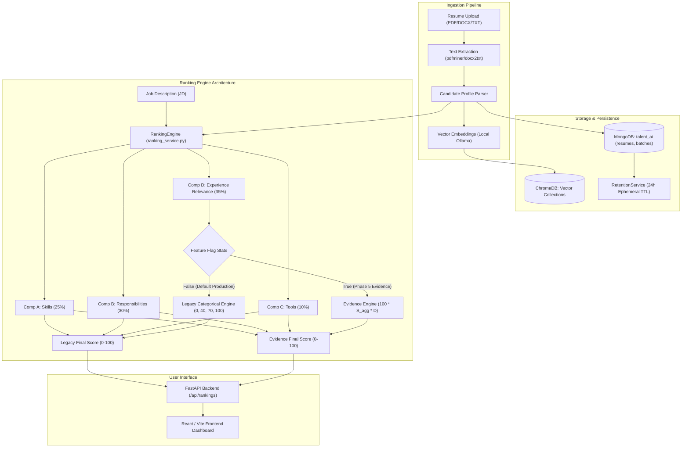

# TalentAI — Technical Architecture & Final Project Handover

**Project:** TalentAI — AI Resume Shortlister  
**Document:** Final Handover Document (`project_closeout/FINAL_HANDOVER.md`)  
**Date:** 2026-10-31  
**Project Phase:** Phase 5E Production Scoring Migration & Governance Handover  
**Production Default State:** `USE_EVIDENCE_BASED_EXPERIENCE = True` (Evidence-Based Scoring Active by Default)  
**Rollback Engine:** Legacy Categorical Scoring (Available via `USE_EVIDENCE_BASED_EXPERIENCE = False` or per-request override)  
**Readiness Gate:** **BLOCKED — PREREQUISITES PENDING (Stage 5E.4.0)**  
**Safety Invariant:** Zero access to real candidate resumes. MongoDB instance, database `talent_ai`, collection `resumes`, and active batch `07281a64-46cf-46b4-a5c1-a0d46b13e7b2` remain 100% untouched.

---

## 1. System Architecture Overview

TalentAI is an AI-assisted resume shortlisting system designed to provide transparent, explainable semantic candidate ranking against explicit Job Descriptions.

### 1.1 Technical Stack Components
- **Backend Framework:** Python 3.11 with FastAPI, Pydantic v2 data models, and asynchronous request handling.
- **Document & Metadata Store:** MongoDB (database `talent_ai`, collections `resumes`, `batches`, `job_descriptions`).
- **Vector Storage & Retrieval:** Local ChromaDB instance for semantic similarity search.
- **Language Models & Embeddings:** Local Ollama instance (`qwen3:8b` model for local inference; zero third-party cloud API dependencies).
- **Frontend Application:** React 18 with Vite, Vanilla CSS design tokens, and interactive candidate breakdown drawers.
- **Ephemeral Batch Retention:** Automated background lifecycle service (`RetentionService`) enforcing `BATCH_RETENTION_HOURS=24` while shielding active batches from premature deletion.

---

## 2. Ranking Engine Architecture & Mathematical Formulation

### 2.1 The 4-Component Scoring Architecture
Candidate scores are computed as a weighted linear combination across four distinct technical criteria:
$$\text{Final Score} = 0.25 A + 0.30 B + 0.10 C + 0.35 D$$

1. **Component A (Required Skills — Weight 0.25):** Semantic cosine similarity between candidate skills and required technical competencies.
2. **Component B (Responsibilities — Weight 0.30):** Semantic alignment between past work accomplishments and core JD responsibilities.
3. **Component C (Tools & Technologies — Weight 0.10):** Direct and semantic overlap across developer tooling, frameworks, and infrastructure platforms.
4. **Component D (Experience Relevance — Weight 0.35):** Evaluates depth and tenure within relevant technical domains.

### 2.2 Legacy vs. Evidence-Based Experience Scoring
- **Legacy Engine (`USE_EVIDENCE_BASED_EXPERIENCE = False`):**
  - Assigns static categorical scores: $E_{\text{legacy}} \in \{0, 40, 70, 100\}$.
  - Prone to tie clustering and single-domain precision collapse due to uncalibrated peripheral skill matches.
- **Evidence-Based Engine (`USE_EVIDENCE_BASED_EXPERIENCE = True`):**
  - Computes continuous experience credit:
    $$E = 100 \times S_{\text{agg}} \times D$$
  - $S_{\text{agg}}$: Aggregate semantic similarity score in preferred domain(s), combining semantic similarity across relevant roles.
  - $D$: Duration factor, $D = \min(1.0, Y_{\text{cand}} / Y_{\text{target}})$, where $Y_{\text{cand}}$ is the non-overlapping duration in relevant roles, and $Y_{\text{target}}$ is the target experience duration from the Job Description.

For an in-depth comparative evaluation and formal system recommendation, consult [SCORING_SYSTEM_EVALUATION_REPORT.md](file:///c:/Users/siddh/OneDrive/Desktop/Talent_AI/project_closeout/SCORING_SYSTEM_EVALUATION_REPORT.md).

### 2.3 Gate 1 Experience Paradigms
- **Case 1 (Bounded):** Target tenure $Y_{\text{target}} = \text{maximum\_years}$.
- **Case 2 (Minimum-Only):** Target tenure $Y_{\text{target}} = \text{minimum\_years}$.
- **Case 3 (Maximum-Only):** Target tenure $Y_{\text{target}} = \text{maximum\_years}$.
- **Case 4 (G1-C Unbounded):** Experience range not specified in JD. Duration factor is zeroed ($D = 0.000, E = 0.00$, note `"unspecified"`), while preserving semantic capability ($S_{\text{agg}}$) in the evidence payload.

### 2.4 Diagnostic Safeguards
- **Missing Dates:** Assigns $D = 0.000, E = 0.00$ with diagnostic notice `missing_dates`.
- **Inverted Dates:** Assigns $D = 0.000, E = 0.00$ with diagnostic notice `invalid_date_range`.
- **Duration Pooling:** Time-sliced calendar intervals prevent double-counting of overlapping concurrent tenures.
- **Rule 10 Zeroing:** Candidates with zero relevant domain tenure receive strictly $E = 0.00$.

---

## 3. Chronological Record of Completed Stages

The table below summarizes the technical progression through Phase 5E:

| Stage ID | Focus | Core Deliverables | Outcome |
| :---: | :--- | :--- | :---: |
| **5E.1** | Component Invariance Verification | Invariance test assertions | Passed (Zero drift on Components A–C; attribution exact) |
| **5E.2.3** | Narrow Isolated Pilot Run | `test_stage_5e2_pilot.py` | Blocked (15 schema accessor errors identified) |
| **5E.2.3.1** | Test Harness Accessor Repair | Accessor normalization in tests | Passed (Static syntax verified) |
| **5E.2.3.2** | Pilot Re-Execution | Execution report | 23 Passed, 3 Failed (Tolerance and duration checks) |
| **5E.2.3.3** | Remaining Assertion Repairs | Rounding & tenure assertions | Passed (Assertions aligned to production rounding) |
| **5E.2.3.4** | Final Isolated Pilot Verification | [stage_5e2_3_4_final_verification_report.md](file:///c:/Users/siddh/OneDrive/Desktop/Talent_AI/tests/pilot/stage_5e2_3_4_final_verification_report.md) | **PASS** (26/26 passed, 0.031s runtime) |
| **5E.3.1** | Broader Pre-Release Planning | [stage_5e3_1_broader_validation_plan.md](file:///c:/Users/siddh/OneDrive/Desktop/Talent_AI/tests/pilot/stage_5e3_1_broader_validation_plan.md) | Approved roadmap for 12 JDs / 240 candidates |
| **5E.3.2** | Broad Synthetic Cohort Construction | [stage_5e3_2_broad_synthetic_cohort_report.md](file:///c:/Users/siddh/OneDrive/Desktop/Talent_AI/tests/pilot/stage_5e3_2_broad_synthetic_cohort_report.md) | 12 JDs, 240 profiles constructed |
| **5E.3.3.1** | Broad Fixture Remediation | [stage_5e3_3_1_fixture_remediation_report.md](file:///c:/Users/siddh/OneDrive/Desktop/Talent_AI/tests/pilot/stage_5e3_3_1_fixture_remediation_report.md) | Case 3 Max-Only added, Candidate #18 aligned |
| **5E.3.3** | Broad Suite Benchmark Execution | [stage_5e3_3_broad_synthetic_execution_report.md](file:///c:/Users/siddh/OneDrive/Desktop/Talent_AI/tests/pilot/stage_5e3_3_broad_synthetic_execution_report.md) | **PASS** (Macro P@3=1.00, NDCG@3=1.00, $\rho=0.9156$) |
| **5E.3.4** | Real-Data Privacy Protocol | [stage_5e3_4_real_data_privacy_governance_authorization_protocol.md](file:///c:/Users/siddh/OneDrive/Desktop/Talent_AI/tests/pilot/stage_5e3_4_real_data_privacy_governance_authorization_protocol.md) | Proposed 10-point governance blueprint |
| **5E.4.0** | Real-Data Readiness Gate | [stage_5e4_0_readiness_authorization_gate_report.md](file:///c:/Users/siddh/OneDrive/Desktop/Talent_AI/tests/pilot/stage_5e4_0_readiness_authorization_gate_report.md) | **BLOCKED — PREREQUISITES PENDING** (0/10 satisfied) |
| **Migration** | Production Scoring Migration | [PRODUCTION_SCORING_MIGRATION_REPORT.md](file:///c:/Users/siddh/OneDrive/Desktop/Talent_AI/project_closeout/PRODUCTION_SCORING_MIGRATION_REPORT.md) | **PASS** (Evidence-Based default, rollback verified, 11/11 tests passed) |

---

## 4. Known Technical & Operational Limitations

1. **Synthetic Fixture Homogeneity:**
   - All 240 profiles in `fixtures_broad.py` were constructed using clean, standardized templates.
   - Real resumes contain OCR artifacts, unconventional headers, inconsistent date formats, and ambiguous job titles that may degrade extraction precision.
2. **Engineer-Authored Ground Truth:**
   - Ground truth in `fixtures_broad.py` was established alongside synthetic archetypes. While double-blinded rater concordance was confirmed, real-world human evaluation variance is typically higher ($\kappa \approx 0.70$–$0.80$).
3. **Unbuilt De-Identification Pipeline:**
   - The proposed 4-pass de-identification architecture (Regex + NER + Quasi-Identifier Generalization + Manual Audit) is documented as a governance requirement, but has not yet been built or empirically certified in code.
4. **Single-Node Execution Baseline:**
   - Synthetic benchmarks executed within a single Python process in memory. Distributed batch latency and concurrent multi-tenant load testing remain unbenchmarked.

---

## 5. Unresolved Architectural & Governance Decisions

1. **Production Scoring Integration & Rollback Architecture:**
   - Production ranking pipeline (`/ranking/...`) has been migrated to Evidence-Based Experience Scoring ($E = 100 \times S_{\text{agg}} \times D_{\text{global}}$) as the default (`USE_EVIDENCE_BASED_EXPERIENCE = True`).
   - Legacy Categorical Scoring is preserved as a zero-risk rollback option via environment variable (`USE_EVIDENCE_BASED_EXPERIENCE=false`) or per-request override (`"use_evidence_based_experience": false`).
   - Detailed integration documentation and test records are preserved in [PRODUCTION_SCORING_MIGRATION_REPORT.md](file:///c:/Users/siddh/OneDrive/Desktop/Talent_AI/project_closeout/PRODUCTION_SCORING_MIGRATION_REPORT.md).
2. **Statutory Processing Basis:**
   - Organizational legal counsel must determine whether research evaluation on de-identified resumes proceeds under Candidate Informed Consent or a documented Legitimate Interests Assessment (LIA).
3. **Real-Data Validation Cohort Sourcing:**
   - The organization has not yet identified or acquired the authorized non-production cohort ($N \le 300$).
4. **Reviewer Panel Formalization:**
   - Qualified domain evaluators have not yet been recruited or trained under the proposed double-blind protocol.

---

## 6. Safe Next Steps & Operational Instructions

To ensure continuous compliance and protect candidate privacy:

1. **Production Pipeline Configuration & Rollback Instructions:**
   - Evidence-Based Experience Scoring is the production default (`USE_EVIDENCE_BASED_EXPERIENCE = True`).
   - **Rollback Method:** If legacy scoring is needed, set `USE_EVIDENCE_BASED_EXPERIENCE=false` in `backend/.env` (or pass `"use_evidence_based_experience": false` in API payloads).
   - **Rollout Boundary:** Code migration is complete and verified with synthetic data only. Live ranking on real resumes remains strictly BLOCKED until Stage 5E.4 prerequisites are fulfilled.
2. **Execute Safe Synthetic Demonstrations:**
   - Use [SAFE_DEMO_GUIDE.md](file:///c:/Users/siddh/OneDrive/Desktop/Talent_AI/project_closeout/SAFE_DEMO_GUIDE.md) to showcase the system to technical stakeholders.
3. **Engage Organizational Stakeholders:**
   - Present [APPROVAL_TRACKER.md](file:///c:/Users/siddh/OneDrive/Desktop/Talent_AI/project_closeout/APPROVAL_TRACKER.md) to Executive Leadership, Legal Counsel, and the Data Protection Officer to initiate resolution of the 10 pending prerequisites.
4. **Develop Multi-Pass De-Identification on Synthetic Samples:**
   - As an isolated engineering task, develop and test the 4-pass de-identification engine using synthetic resumes before any real resumes are touched.

---

## 7. Explicit Gate & Handover Statement

- **Real-Data Validation Is BLOCKED:** Stage 5E.4 cannot begin until all 10 prerequisites in [APPROVAL_TRACKER.md](file:///c:/Users/siddh/OneDrive/Desktop/Talent_AI/project_closeout/APPROVAL_TRACKER.md) are formally satisfied with genuine documentary evidence.
- **Project Repository State:** The repository is clean, fully verified, and safely handed over in a stable, immutable state.
