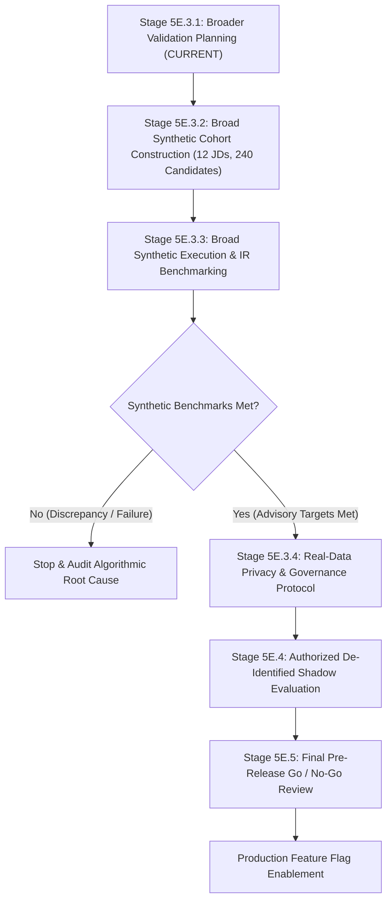

# TalentAI — Stage 5E.3.1: Broader Prerelease Validation Plan

**Document Status:** Formal Planning Specification (Stage 5E.3.1 Planning ONLY)  
**Execution Authority:** Authorization for Planning and Read-Only Review ONLY  
**Target Feature Flag:** `USE_EVIDENCE_BASED_EXPERIENCE = False` (Preserved and untouched)  
**Target Database:** `talent_ai` (Preserved, isolated, and untouched)  
**Active Production Batch:** `07281a64-46cf-46b4-a5c1-a0d46b13e7b2` (Preserved, isolated, and untouched)

---

## 1. Executive Summary & Objective

In Stage 5E.2.3.4, the isolated synthetic pilot test suite ([tests/pilot/test_stage_5e2_pilot.py](file:///c:/Users/siddh/OneDrive/Desktop/Talent_AI/tests/pilot/test_stage_5e2_pilot.py)) achieved a 100% pass rate (26/26 tests passed) with zero runtime errors and zero assertion failures. The verified outputs demonstrated:
- 100% numerical invariance of Components A, B, and C between legacy and evidence engines.
- Strict attribution of final score movements to Component D: $\Delta_{\text{final}} = 0.35 \times (E_{\text{ev}} - E_{\text{leg}})$.
- Reliable enforcement of duration safeguards (Gate 1 Rule C unbounded target and missing dates both evaluate to $D = 0.000, E = 0.00$).
- 66.7% overall reduction in score ties across the pilot cohort.

However, **this initial cohort was limited to 24 synthetic candidate profiles across 3 synthetic Job Descriptions.** As explicitly established in Stage 5E.2.1, an exploratory cohort of this size is mathematically sufficient to verify formula implementation and edge-case mechanics, but **it is not statistically powered or empirically sufficient to prove real-world ranking quality, recruiter alignment, or production readiness.**

### Objective of Stage 5E.3.1
This plan establishes a comprehensive, actionable roadmap for broader prerelease validation of evidence-based experience ranking prior to any consideration of feature-flag activation or live release.

---

## 2. Current Evidence & Inherent Limitations

### 2.1 What the Current Evidence Proves
The validation completed across Stages 5E.1, 5E.1.1, 5E.2, 5E.2.3.1, 5E.2.3.2, 5E.2.3.3, and 5E.2.3.4 demonstrates:
1. **Mathematical Correctness:** The evidence-based experience formula $E = 100 \times S_{\text{agg}} \times D_{\text{global}}$ correctly integrates per-domain maximum calibrated similarity and global tenure damping.
2. **Component Isolation:** Components A, B, and C are entirely unaffected by Component D scoring logic, ensuring no unintended cross-component leakage.
3. **Time-Sliced Tenure Pooling:** The approved weighted interval pooling algorithm correctly resolves concurrent roles using $\max(r_k)$, rejecting unweighted unions.
4. **Diagnostic Provenance:** Provenance fields (`supporting_role`, `supporting_company`, `calibrated_similarity`, `notes`) are preserved in the Pydantic result model.

### 2.2 Critical Limitations of Synthetic Evidence
Despite technical success, synthetic evaluation has distinct blind spots that preclude immediate release:

| Limitation Area | Nature of Limitation | Potential Real-World Failure Mode |
| :--- | :--- | :--- |
| **Sample Size & Power** | $N = 24$ candidates across 3 JDs is exploratory. Confidence intervals on NDCG and Precision are wide ($\pm 0.15$–$0.25$). | Failure to detect ranking degradation in long-tail candidate distributions. |
| **Domain Diversity** | Evaluated only 3 technical roles: Backend/Fintech, NLP/ML, and Cloud Systems. | Unverified performance on Frontend, Mobile, DevOps, Data Science, Security, QA, and Non-Software technical domains. |
| **Extraction Cleanliness Bias** | Synthetic candidate inputs feature pre-cleaned, well-formed JSON structures without extraction noise. | Real-world resumes contain OCR errors, multi-column layout corruption, missing company names, and unconventional date strings (e.g. "Summer 2021", "Present", "Q3 2019"). |
| **Duration Granularity Bias** | Synthetic profiles use round month/year boundaries (e.g., exactly 3.0 years or 4.0 years). | Real careers feature fractional gaps, overlapping gigs, sabbaticals, and ambiguous current employment dates. |
| **Semantic Terminology Bias** | Candidate work summaries and JD domains were crafted by engineers with domain knowledge. | In practice, candidates use non-standard synonyms, colloquialisms, internal corporate project names, or proprietary jargon. |
| **Ground-Truth Circularity** | Synthetic profiles were designed to fit specific archetypes, making human grading straightforward. | Real candidate evaluation involves subjective tradeoffs (e.g. 8 years at a lesser-known startup vs. 3 years at a Tier-1 tech firm). |

---

## 3. Proposed Broader Validation Scope & Cohort Design

To overcome these limitations, a scaled prerelease validation cohort must be constructed and evaluated across varied job families, experience range paradigms, and edge-case perturbations.

### 3.1 Target Cohort Sizing
- **Synthetic Broad Cohort:** **12 Job Descriptions**, **240 Candidate Profiles** (20 candidates per JD cohort).
- **Sub-Cohort Stratification:**
  - 120 In-Cohort Candidates (10 core candidate archetypes per JD spanning Grades 0 to 3).
  - 60 Tenure Boundary & Damping Stress Profiles (evaluating $D = 0.25, 0.50, 0.75, 1.00, 1.25$).
  - 36 Extraction Noise & Missing-Date Perturbation Profiles.
  - 24 Identical & Near-Identical Twin Pairs (evaluating deterministic rank stability).

---

### 3.2 Stratification Across Job Families & Disciplines

The 12 Job Descriptions will be divided across 6 distinct technical and engineering strata:

| Stratum # | Technical Discipline / Job Family | Archetype Title | Experience Specification | Preferred Domains ($M$) |
| :---: | :--- | :--- | :--- | :--- |
| **Stratum 1** | **Backend & Distributed Systems** | Principal Distributed Backend Engineer | Case 1: Bounded (4.0–8.0y, $Y_{\text{target}}=8.0$) | Distributed Storage, Consensus Systems ($M=2$) |
| | | Junior/Mid Microservices Dev | Case 1: Bounded (2.0–4.0y, $Y_{\text{target}}=4.0$) | REST APIs, Event-Driven Architecture ($M=2$) |
| **Stratum 2** | **Frontend, Mobile & Full-Stack** | Lead React / Next.js Architect | Case 2: Min-Only ($\ge 5.0\text{y}$, $Y_{\text{target}}=5.0$) | Modern Web Platforms, Performance Optimization ($M=2$) |
| | | Senior iOS / Mobile Systems Dev | Case 1: Bounded (3.0–6.0y, $Y_{\text{target}}=6.0$) | iOS Frameworks, Swift/SwiftUI, Offline Sync ($M=2$) |
| **Stratum 3** | **AI, Machine Learning & Data** | Senior MLOps / AI Platform Engineer | Case 2: Min-Only ($\ge 4.0\text{y}$, $Y_{\text{target}}=4.0$) | Model Serving, Pipeline Orchestration, LLMOps ($M=2$) |
| | | Data Platform Infrastructure Engineer | Case 1: Bounded (3.0–7.0y, $Y_{\text{target}}=7.0$) | Apache Spark, Real-Time Streaming, Lakehouse ($M=2$) |
| **Stratum 4** | **DevOps, SRE & Cloud Infra** | Senior Site Reliability Engineer | Case 1: Bounded (4.0–7.0y, $Y_{\text{target}}=7.0$) | Incident Response, Observability, K8s Reliability ($M=2$) |
| | | Cloud Infrastructure Architect | Case 4: G1-C Unbounded (No duration) | Multi-Cloud Architecture, Terraform/IaC ($M=2$) |
| **Stratum 5** | **Security & Systems Engineering** | Senior Cloud Security Engineer | Case 2: Min-Only ($\ge 4.0\text{y}$, $Y_{\text{target}}=4.0$) | Zero Trust, IAM, Threat Modeling, DevSecOps ($M=3$) |
| | | Embedded Systems / Firmware Dev | Case 1: Bounded (3.0–5.0y, $Y_{\text{target}}=5.0$) | RTOS, C/C++, Hardware Interfaces ($M=1$) |
| **Stratum 6** | **Quality & Engineering Leadership** | Staff Software Engineer in Test (SDET) | Case 2: Min-Only ($\ge 3.0\text{y}$, $Y_{\text{target}}=3.0$) | Test Automation Frameworks, CI/CD Pipeline QA ($M=1$) |
| | | Engineering Manager / Technical Lead | Case 4: G1-C Unbounded (No duration) | Engineering Leadership, Agile Delivery, Architecture ($M=2$) |

---

### 3.3 Experience Range Paradigm Coverage

The broader cohort must systematically test all approved Gate 1 experience paradigms:
1. **Bounded Range (Case 1):** $\text{Min} > 0, \text{Max} > 0 \implies Y_{\text{target}} = \text{Max}$. Validates duration factor $D = \min(1.0, Y_{\text{actual}} / \text{Max})$.
2. **Minimum-Only Range (Case 2):** $\text{Min} > 0, \text{Max} = \text{None} \implies Y_{\text{target}} = \text{Min}$. Validates duration factor $D = \min(1.0, Y_{\text{actual}} / \text{Min})$.
3. **Maximum-Only Range (Case 3):** $\text{Min} = \text{None}, \text{Max} > 0 \implies Y_{\text{target}} = \text{Max}$. Validates duration factor $D = \min(1.0, Y_{\text{actual}} / \text{Max})$.
4. **Unbounded Target (Case 4 / Gate 1 Rule C):** $\text{Min} = \text{None}, \text{Max} = \text{None} \implies D = 0.000, E = 0.00$ with `range_status="unspecified"`.
5. **No Preferred Domains Defined:** Total criteria $M = 0 \implies$ Component D status `not_applicable`, dynamic weight renormalization to remaining categories.

---

### 3.4 Specific Edge Cases & Adversarial Perturbations

To stress-test model safeguards, the cohort will incorporate deliberate edge conditions:
- **Tenure Fragmentation:** Candidates with 5+ short-term contract stints ($< 6$ months each) vs. single long-tenure role.
- **Unverified & Malformed Dates:**
  - Complete omission of employment dates on one or all roles.
  - Future dates or inverted intervals (e.g., start date > end date).
  - Ambiguous date strings (e.g., year only, "2020 - 2021" vs exact dates).
- **Concurrent Overlapping Roles:** Multiple simultaneous roles with conflicting relevance decisions (e.g., Role A is `RELEVANT` with $r_k=1.0$; concurrent Role B is `AMBIGUOUS` with $r_k=0.5$).
- **Domain Mismatch & Zero-Filling Denominator:** Candidates having high semantic similarity in an unrequested domain, verifying $S_m = 0.00$ for preferred domains not supported.
- **Rule 10 Zero-Credit Invariant:** Non-technical or totally irrelevant roles (e.g. Sales, Culinary, Real Estate) paired with technical JDs, confirming zero score leakage ($E = 0.00$).

---

## 4. Candidate Ground-Truth Labeling & Adjudication Protocol

To eliminate rater bias and ground-truth circularity, a formal human relevance evaluation protocol will be utilized.

### 4.1 Independent Double-Blind Annotation
1. **Recruiter Panels:** Each candidate profile within a cohort is independently reviewed by two domain-experienced technical recruiters (Rater 1 and Rater 2).
2. **Blinding:** Raters evaluate only the Candidate Resume/Profile and the Job Description. They have zero access to model scores, legacy scores, evidence breakdowns, or algorithm internals.
3. **Evaluation Rubric:**

| Relevance Grade | Category Label | Operational Definition for Raters | Binary Relevance |
| :---: | :--- | :--- | :---: |
| **Grade 3** | **Exceptional Fit** | Candidate fully satisfies required skills, core responsibilities, and has verified tenure meeting or exceeding duration in target domain(s). Clear top shortlist candidate. | **Relevant (1)** |
| **Grade 2** | **Good / Partial Fit** | Candidate satisfies majority of requirements with qualifying domain experience, but possesses partial tenure or secondary domain gaps. Defensible interview candidate. | **Relevant (1)** |
| **Grade 1** | **Marginal Fit** | Candidate has tangential technical skills or adjacent background, but lacks qualifying duration or domain depth. Sub-threshold backup candidate. | **Non-Relevant (0)** |
| **Grade 0** | **Unqualified / Irrelevant** | Candidate does not satisfy basic technical requirements or has no relevant industry experience. Unqualified. | **Non-Relevant (0)** |

### 4.2 Inter-Rater Reliability & Consensus Protocol
- **Reliability Metrics:** Compute Cohen's Kappa ($\kappa$) and Quadratic Weighted Kappa ($\kappa_w$) across all dual-rated pairs.
- **Minimum Reliability Threshold (Advisory):** $\kappa \ge 0.70$ and $\kappa_w \ge 0.80$.
- **Adjudication Procedure:**
  - Where Rater 1 and Rater 2 agree: Grade is finalized.
  - Where Raters differ by 1 grade point (e.g. Grade 2 vs Grade 3): A consensus discussion is held, or the arithmetic mean is taken for graded metrics ($g = 2.5$) and mapped to binary relevance ($g \ge 2.0 \implies 1$).
  - Where Raters differ by $\ge 2$ grade points (e.g. Grade 1 vs Grade 3): A third Senior Lead Recruiter acts as blind adjudicator. If consensus cannot be achieved, the profile is flagged as ambiguous and isolated from core IR benchmarks.

---

## 5. Evaluation Metrics & Advisory Acceptance Criteria

The broader validation suite will track information retrieval, rank correlation, tie resolution, and invariance metrics.

> [!IMPORTANT]
> **Advisory Nature of Criteria:**  
> All thresholds listed below are **PROPOSED ADVISORY TARGETS ONLY**. They are established to guide evaluation and do not represent approved production release gates. Formal release gates require separate engineering and product approval.

| Metric Category | Metric Name | Mathematical Definition | Proposed Advisory Target | Evaluation Rationale |
| :--- | :--- | :--- | :---: | :--- |
| **Information Retrieval** | **Precision@3** | $\frac{1}{3} \sum_{i=1}^3 \mathbb{I}(g_i \ge 2)$ | $\ge \mathbf{0.85}$ | Ensures top shortlist is pure high-quality candidates. |
| | **Precision@5** | $\frac{1}{5} \sum_{i=1}^5 \mathbb{I}(g_i \ge 2)$ | $\ge \mathbf{0.80}$ | Ensures recruiter review queue is dense with relevant talent. |
| | **Recall@3** | $\frac{1}{R_{\text{total}}} \sum_{i=1}^3 \mathbb{I}(g_i \ge 2)$ | Report Factual | Quantifies early capture of cohort relevant candidates. |
| | **Recall@5** | $\frac{1}{R_{\text{total}}} \sum_{i=1}^5 \mathbb{I}(g_i \ge 2)$ | $\ge \mathbf{0.75}$ | Verifies top-5 captures at least three-quarters of relevant pool. |
| | **NDCG@3** | $\frac{\text{DCG}_3}{\text{IDCG}_3}, \quad \text{gain} = 2^g - 1$ | $\ge \mathbf{0.90}$ | Verifies optimal ranking order among top-3 candidates. |
| | **NDCG@5** | $\frac{\text{DCG}_5}{\text{IDCG}_5}, \quad \text{gain} = 2^g - 1$ | $\ge \mathbf{0.88}$ | Penalizes ranking lower-grade candidates above higher-grade ones. |
| | **Mean Reciprocal Rank (MRR)** | $\frac{1}{|Q|} \sum \frac{1}{\text{rank}_{\text{first relevant}}}$ | $\ge \mathbf{0.95}$ | Confirms first relevant candidate appears at rank #1 or #2. |
| **Rank Correlation** | **Spearman's $\rho$** | $1 - \frac{6 \sum d_i^2}{n(n^2 - 1)}$ | $\ge \mathbf{0.80}$ | Measures monotonic alignment between model rank and human rank. |
| | **Kendall's $\tau$** | $\frac{C - D}{\frac{1}{2} n (n - 1)}$ | $\ge \mathbf{0.65}$ | Confirms pairwise ordering agreement. |
| **Tie Resolution** | **Cohort Tie Rate** | $\frac{\text{Tied Pairs}}{\binom{N}{2}}$ | $\le \mathbf{0.05}$ | Minimizes score collisions across the candidate pool. |
| | **Top-5 Tie Rate** | $\frac{\text{Tied Pairs in Top 5}}{\binom{5}{2} = 10}$ | $\le \mathbf{0.05}$ | Eliminates recruiter ambiguity in top shortlist selection. |
| | **Tie Reduction vs Legacy** | $1 - \frac{\text{TieRate}_{\text{ev}}}{\text{TieRate}_{\text{leg}}}$ | $\ge \mathbf{50.0\%}$ | Confirms substantial tie reduction compared to categorical engine. |
| **Invariance & Attribution** | **Components A, B, C Delta** | $|S_{A,B,C}^{\text{evidence}} - S_{A,B,C}^{\text{legacy}}|$ | $\mathbf{0.000}$ Strictly | Proves non-experience scoring components are 100% invariant. |
| | **Score Delta Attribution** | $|\Delta_{\text{final}} - 0.35 \cdot \Delta_{\text{exp}}|$ | $\le \mathbf{0.010}$ | Confirms final score delta is 100% attributable to Component D within 2-decimal display precision. |

---

## 6. Separation: Synthetic vs. Authorized Real-Data Validation

A critical architectural distinction must be maintained between what can be evaluated using synthetic data and what requires representative, authorized data:

```
+---------------------------------------------------------------------------------------------+
|                               VALIDATION DOMAIN SEPARATION                                  |
+---------------------------------------------------------------------------------------------+
|                                                                                             |
|   SYNTHETIC VALIDATION (Stage 5E.3.x)            AUTHORIZED REAL-DATA PILOT (Stage 5E.4+)   |
|   - Zero PII, zero privacy risk                  - Authorized, de-identified resumes only   |
|   - Deterministic, reproducible CI test          - Non-production shadow environment        |
|   - Algorithmic formula verification             - Live recruiter feedback & shadow ranking |
|   - Components A-C invariance proofs             - Unstructured text & extraction noise     |
|   - Extreme boundary stress-testing              - Real date formatting & career gaps       |
|   - Tie reduction mathematical verification      - Colloquial phrasing & terminology drift  |
|                                                                                             |
+---------------------------------------------------------------------------------------------+
```

### 6.1 Delineation Matrix

| Evaluation Dimension | Synthetic Validation (Stage 5E.3.x) | Authorized Real-Data Validation (Stage 5E.4+) |
| :--- | :--- | :--- |
| **Formula & Mathematics** | Fully capable. Verifies $E = 100 \times S_{\text{agg}} \times D_{\text{global}}$, saturation, and linear damping. | Confirm consistency on real score spreads. |
| **Tenure Damping & Tie Resolution** | Fully capable. Proves tie reduction on controlled duration steps. | Measure actual tie reduction in real recruiter applicant pools. |
| **Component Invariance** | Fully capable. Proves Components A, B, C identical down to $10^{-6}$. | Validates component independence across real extract payloads. |
| **Resume Extraction Noise** | Limited. Simulated noise only; cannot capture full variety of PDF parser failures. | Essential. Exposes real-world date formatting anomalies, multi-column OCR bugs, and unparsed job titles. |
| **Semantic Drift & Jargon** | Limited. Curated synonyms cannot anticipate proprietary company jargon. | Essential. Tests embedding similarity model on natural candidate phrasing. |
| **Recruiter Trust & Utility** | Limited. Validates schema payload and notes; cannot measure human satisfaction. | Essential. Measures recruiter acceptance rate of model top shortlists. |

### 6.2 Requirements for Any Future Authorized Real-Data Testing (Stage 5E.4+)
Before any authorized real-world resume testing may occur, all of the following prerequisites must be formally satisfied:
1. **Explicit Executive & Legal Authorization:** Specific written authorization for candidate resume evaluation.
2. **De-Identification & PII Stripping:** Automated redaction of candidate names, phone numbers, email addresses, physical addresses, and educational institution names.
3. **Database & Batch Isolation:** Real-data evaluation must occur in an isolated scratch environment. Under no circumstances may active batch `07281a64-46cf-46b4-a5c1-a0d46b13e7b2` or database `talent_ai` be queried, modified, or populated.
4. **Read-Only Shadow Mode:** Candidate scores must be generated in read-only shadow files without writing to active candidate records.

---

## 7. Phased Prerelease Validation Roadmap



### 7.1 Stage Breakdown

#### Stage 5E.3.1 (Current): Broader Prerelease Validation Planning ONLY
- **Deliverable:** `tests/pilot/stage_5e3_1_broader_validation_plan.md`.
- **Constraint:** Zero code edits, zero test executions, zero database access.

#### Stage 5E.3.2: Construction of Broad Synthetic Cohort (12 JDs, 240 Candidates)
- **Prerequisites:** Approval of Stage 5E.3.1 planning document.
- **Action:** Construct in-memory fixtures for 12 JDs across 6 strata and 240 synthetic candidate profiles with independent human relevance ground truth.
- **Deliverables:** `tests/pilot/fixtures_broad.py`, updated test runner.
- **Constraint:** Construction only; no execution.

#### Stage 5E.3.3: Execution of Broad Synthetic Suite & IR Benchmarking
- **Prerequisites:** Completed construction of Stage 5E.3.2 fixtures.
- **Action:** Execute the broadened test runner; evaluate Precision@K, Recall@K, NDCG@K, Spearman's $\rho$, and tie rates across all 12 cohorts.
- **Deliverable:** `tests/pilot/stage_5e3_3_broad_execution_report.md`.
- **Constraint:** Stop if any test fails or any advisory target is missed.

#### Stage 5E.3.4: Real-Data Privacy, Governance & Authorization Protocol
- **Prerequisites:** All Stage 5E.3.3 synthetic benchmarks met.
- **Action:** Define the PII stripping pipeline, data retention rules, and legal authorization boundary for de-identified resume testing.
- **Deliverable:** `tests/pilot/stage_5e3_4_data_governance_protocol.md`.

#### Stage 5E.4: Authorized De-Identified Shadow Evaluation (Future Phase)
- **Prerequisites:** Explicit authorization and completed Stage 5E.3.4 protocol.
- **Action:** Run dual-scoring in a non-production shadow pipeline on $\ge 300$ de-identified production-representative resumes.

#### Stage 5E.5: Production Release Readiness Review & Go/No-Go Decision
- **Action:** Executive review of synthetic and shadow evaluations. Formal Go/No-Go decision on enabling `USE_EVIDENCE_BASED_EXPERIENCE = True`.

---

## 8. Prerequisites, Risks & Stop Conditions

### 8.1 Key Prerequisites
- **Stage Progression Gate:** No subsequent stage may commence without explicit written authorization following review of the preceding stage deliverable.
- **Production Immutability:** Throughout all validation stages, production code, weights, formulas, schemas, `.env`, and active batches remain strictly immutable.

### 8.2 Risk Assessment & Mitigation

| Identified Risk | Severity | Likelihood | Mitigation Strategy |
| :--- | :---: | :---: | :--- |
| **Synthetic Overfitting** | High | Medium | Broaden evaluation across 6 distinct technical strata; include edge cases and noisy text. |
| **Ground-Truth Subjectivity** | Medium | High | Require dual-blind annotation with formal Kappa inter-rater agreement measurement ($\kappa \ge 0.70$). |
| **Unintended Flag Leakage** | Critical | Low | Continue strict runtime assertions that global `USE_EVIDENCE_BASED_EXPERIENCE` is immutable and defaults to `False`. |
| **Production Data Contamination** | Critical | Low | Hardcode test runners to use in-memory fixtures; zero connection strings to production MongoDB. |
| **Long-Tail Performance Degradation** | Medium | Medium | Track false negatives at rank #4 and #5; conduct granular error analysis on borderline candidates. |

### 8.3 Mandatory Stop Conditions
Execution must immediately halt, with zero code modifications, if any of the following occur:
1. **Invariance Breach:** Any candidate exhibits a non-zero score difference ($|\Delta| > 0.000$) in Components A, B, or C between engines.
2. **Attribution Discrepancy:** Final score delta deviates from $0.35 \times \Delta_{\text{exp}}$ by more than display rounding tolerance ($> 0.010$).
3. **Severe Ranking Inversion:** A candidate with human Grade 0 outranks a candidate with human Grade 3 within any cohort.
4. **Inter-Rater Consensus Failure:** Recruiter agreement drops below $\kappa < 0.60$, indicating an ambiguous or defective rubric.
5. **Database Contact Attempt:** Any attempt by test runners to open network sockets or connect to MongoDB.

---

## 9. Safety Invariants & Scope Verification

| Safety Invariant | Verification Method & Finding | Status |
| :--- | :--- | :---: |
| **No Test Execution** | Zero test runner executions were initiated during Stage 5E.3.1. | **CONFIRMED** |
| **No Metric Calculations** | Zero new metrics were computed or estimated in this stage. | **CONFIRMED** |
| **No File Modifications Outside Plan** | Only `tests/pilot/stage_5e3_1_broader_validation_plan.md` was created. | **CONFIRMED** |
| **Fixtures & Tests Untouched** | `fixtures.py`, `metrics.py`, and `test_stage_5e2_pilot.py` remain untouched. | **CONFIRMED** |
| **Production Code Untouched** | All backend ranking services, schemas, and configurations remain untouched. | **CONFIRMED** |
| **Configuration & `.env` Untouched** | `backend/.env` remains untouched since Oct 28. | **CONFIRMED** |
| **Feature Flag Immutability** | `USE_EVIDENCE_BASED_EXPERIENCE` remains strictly `False`. | **CONFIRMED** |
| **MongoDB & Production Data Isolated** | Zero database connections; batch `07281a64-46cf-46b4-a5c1-a0d46b13e7b2` untouched. | **CONFIRMED** |
| **Zero Live APIs Called** | No network requests executed. | **CONFIRMED** |
| **No Progression to Stage 5E.3.2** | Work halted immediately upon plan document generation. | **CONFIRMED** |

---

## 10. Stopping Point

Stage 5E.3.1 is complete. In strict adherence to your instructions:
- Antigravity has stopped and will not construct fixtures, execute tests, or modify any files.
- Awaiting user review and explicit authorization before proceeding to **Stage 5E.3.2: Construction of Broad Synthetic Evaluation Cohort**.
