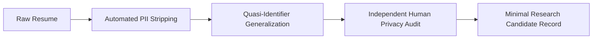
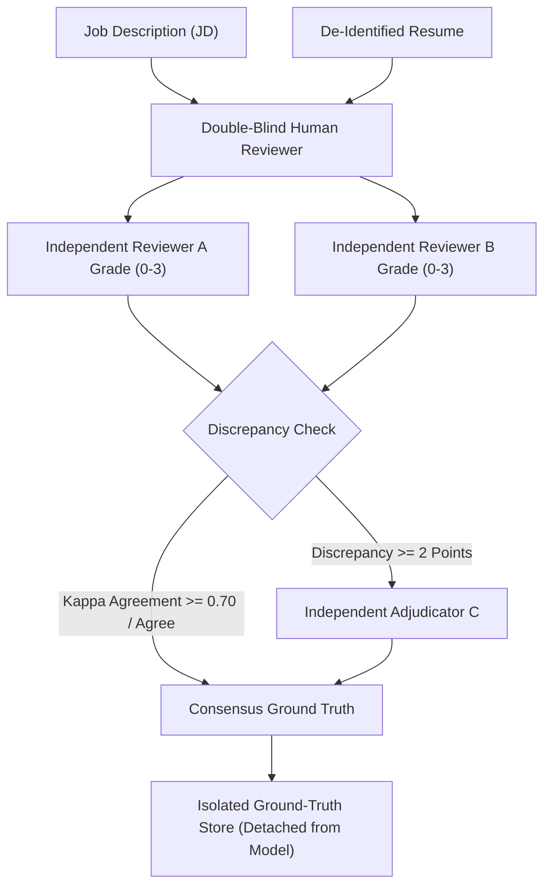

# TalentAI — Stage 5E.3.4: Real-Data Privacy, Governance & Authorization Protocol

**Project:** TalentAI — AI Resume Shortlister  
**Stage:** 5E.3.4 (Real-Data Privacy, Governance & Authorization Protocol)  
**Mode:** Documentation and Read-Only Inspection Only  
**Protocol Status:** **PROPOSED GOVERNANCE BLUEPRINT — ALL PREREQUISITES PENDING**  
**Execution Authority:** Pre-Release Validation Governance  
**Safety Invariant:** Zero access, reading, parsing, or processing of real resumes or candidate records. MongoDB instance, database `talent_ai`, collection `resumes`, and active batch `07281a64-46cf-46b4-a5c1-a0d46b13e7b2` remain 100% untouched. Feature flag `USE_EVIDENCE_BASED_EXPERIENCE=False` strictly preserved.

---

## 1. Executive Summary & Purpose

This document establishes the formal privacy, data protection, ethical governance, and legal authorization protocol required **prior to any real-data validation** of TalentAI's evidence-based experience ranking engine.

Following the successful execution of the broad synthetic validation benchmark in Stage 5E.3.3 ([stage_5e3_3_broad_synthetic_execution_report.md](file:///c:/Users/siddh/OneDrive/Desktop/Talent_AI/tests/pilot/stage_5e3_3_broad_synthetic_execution_report.md))—which achieved Macro Precision@3 of 1.0000, NDCG@3 of 1.0000, Spearman $\rho = 0.9156$, and a 54.2% tie reduction across 12 synthetic JDs and 240 synthetic profiles—the system demonstrated algorithmic fidelity on clean, deterministic synthetic data.

However, synthetic data cannot replicate the noise, syntactic ambiguity, formatting variance, non-standard chronology, or demographic heterogeneity inherent in real candidate resumes. Moving to real-data validation introduces fundamental privacy, confidentiality, regulatory, and ethical risks.

> [!CRITICAL]
> **Strict Authorization Boundary**  
> This protocol is a **documentation-only governance framework**. It does **NOT** constitute authorization to access, upload, parse, inspect, or process real candidate resumes or personal data. All authorization prerequisites defined in this document are currently **Not Obtained / Pending**. Stage 5E.4 cannot commence until every prerequisite is formally satisfied and explicitly authorized in writing.

---

## 2. Read-Only Project Audit Findings

A read-only audit of existing project artifacts, configurations, and historical documentation was conducted to determine the current validation baseline and data governance posture.

### 2.1 Current Benchmark Scope vs. Excluded Systems

| System / Asset | Current Benchmark Posture (Stage 5E.3) | Real-Data Posture | Audit Finding |
| :--- | :--- | :--- | :--- |
| **Candidate Cohort** | 100% synthetic in-memory fixtures (`fixtures_broad.py`, `fixtures.py`) | Real candidate resumes | Zero real resumes used in any benchmark to date. |
| **Personal Identifiable Info (PII)** | Completely absent (fictional archetypes) | Present in raw resumes | No PII has been processed in testing. |
| **Production Database** | Untouched (no connection strings in tests) | Database `talent_ai`, collection `resumes` | Database isolated; active batch `07281a64-46cf-46b4-a5c1-a0d46b13e7b2` intact. |
| **Vector Storage** | Untouched (pure Python cosine similarity) | Local ChromaDB collections | ChromaDB not invoked during synthetic benchmarking. |
| **Inference Models** | Deterministic mock representations | Local Ollama (`qwen3:8b`) / Embeddings | Offline deterministic math only; zero model calls. |
| **External Network / APIs** | Completely air-gapped / offline | Third-party APIs / LLMs | Zero external network calls permitted or observed. |
| **Feature Flag** | `USE_EVIDENCE_BASED_EXPERIENCE = False` | Must remain `False` | Feature flag strictly disabled by default in `ranking_config.py`. |

### 2.2 Known Data Flows from Existing Documentation

Based on the inspection of `backend/app/services/retention_service.py`, `backend/.env`, and `backend/test_data/evaluation/phase_9_3/evaluation_protocol.md`:
1. **Production Ingestion Pipeline:** Incoming resumes are received via multipart HTTP upload -> saved to temporary disk (`app/uploads/incoming`) -> text is extracted into `app/uploads/extracted` (or routed to `app/uploads/failed`) -> candidate profile documents are constructed -> vectorized -> stored in MongoDB `talent_ai` under an upload batch ID.
2. **Ephemeral Retention Engine:** TalentAI implements an automated retention service (`RetentionService`) governed by `.env` parameters `BATCH_RETENTION_HOURS=24` and `BATCH_CLEANUP_INTERVAL_MINUTES=60`. Expired batches and associated files are deleted periodically, while active batches (such as protected batch `07281a64-46cf-46b4-a5c1-a0d46b13e7b2`) are shielded from deletion.
3. **Diagnostic Logging Resilience:** As verified in `test_ollama_resilience.py`, error logging paths are explicitly sanitized to prevent raw prompts or candidate PII from leaking into application logs.
4. **Historical Evaluation Principles:** Phase 9.3 evaluation protocol (`phase_9_3/evaluation_protocol.md`) articulated foundational ethical intentions: written informed consent, full PII de-identification, local processing without external LLM transmission, and double-blind rater scoring.

### 2.3 Unknowns and Unverified Assumptions (Must Not Be Assumed)

The audit revealed critical gaps between informal engineering documentation and formal organizational compliance:
- **Unknown Candidate Consent Status:** It is unknown whether real resumes currently in storage or accessible in test directories were collected with informed, documented consent for automated algorithmic ranking research.
- **Unknown Legal Processing Basis:** No legal determination (e.g., under GDPR Article 6/9, CCPA/CPRA, NYC Local Law 144, or EEOC Uniform Guidelines on Employee Selection Procedures) has been documented or approved by organizational legal counsel.
- **Unknown Data Ownership & Third-Party Restrictions:** It is unknown whether candidate resumes originate from direct applicants, recruitment agencies, public repositories, or commercial datasets, each of which carries distinct contractual restrictions.
- **Unknown Specific Retention Policy for Research:** While production batches expire in 24 hours, no retention schedule or secure destruction procedure has been legally defined for non-production evaluation datasets.
- **Unknown Organizational Governance Contacts:** No formal Data Protection Officer (DPO), Chief Privacy Officer, or legal compliance lead is identified in the repository configuration.
- **Unverified De-Identification Performance:** No automated PII stripping pipeline in the repository has been empirically validated or certified against re-identification leakage on real resumes.

---

## 3. Scope and Operational Purpose of Real-Data Validation

### 3.1 Proposed Purpose of Real-Data Validation (Future Stage 5E.4)
The sole permissible objective of future real-data validation is:
- To evaluate whether the ranking agreement, precision stability, and tie-resolution capabilities demonstrated by the Evidence-Based Ranking Engine in Stage 5E.3.3 generalize to real-world resumes characterized by non-standard formatting, varied chronology, fragmented tenure, and diverse linguistic styles.
- To compare the evidence-based engine ($E = 100 \times S_{\text{agg}} \times D$) against the legacy categorical engine ($E_{\text{legacy}} \in \{0, 40, 70, 100\}$) in an offline shadow evaluation mode.

### 3.2 Strict Separation from Production and Hiring Decisions
- **Non-Production Research Only:** Real-data validation must be executed in a dedicated, isolated offline evaluation harness.
- **Zero Impact on Employment Decisions:** Candidate rankings generated during validation must **never** be used for:
  - Live candidate shortlisting, screening, or filtering.
  - Advancing, interviewing, or rejecting actual job applicants.
  - Informing recruiter decisions, hiring manager assessments, or employment offers.
  - Communicating scores, grades, or rankings to candidates or recruiters.
- **Prohibition of Automated Decision-Making (AEDT):** TalentAI is strictly an algorithmic decision-support research artifact in this phase, not an Automated Employment Decision Tool.

---

## 4. Data Minimization & Field Redaction Specification

Under the principle of data minimization, any dataset prepared for real-data validation must contain only the minimum necessary information required to evaluate technical experience and qualification alignment.



### 4.1 Permitted Data Fields (Strict Minimum)

| Data Category | Permitted Specific Fields | Purpose in Validation |
| :--- | :--- | :--- |
| **Work History Chronology** | Start month/year, end month/year (or "present" indicator) | Required for duration calculation ($Y_{\text{cand}}$), overlapping role resolution, and saturation factor ($D$). |
| **Role Titles** | Standardized functional titles (e.g., "Senior Software Engineer") | Required for semantic domain classification and relevance scoring. |
| **Industry / Domain Context** | Generalized industry classifications (e.g., "Fintech / Payments", "Healthcare IT") | Required for domain relevance calibration ($M$). Specific company names redacted. |
| **Technical Experience Evidence** | Bullet points describing responsibilities, system architecture, tools utilized, and technical accomplishments | Required for semantic similarity calculation ($S_{\text{agg}}$) against JD requirements. |
| **Skills & Tools Inventory** | Explicit technical competencies (e.g., Python, Kubernetes, PostgreSQL) | Required for Component A (Skills 25%) and Component C (Tools 10%) scoring. |
| **Educational Degree Level** | Degree type and major area of study (e.g., "B.S. in Computer Science") | Required for basic qualification matching. All institutions and graduation dates redacted. |

### 4.2 Prohibited & Redacted Fields (Must Be Scrubbed)

The following fields must be permanently stripped and excluded from any validation dataset:

1. **Direct Personal Identifiers:**
   - Full legal name, first/middle/last names, initials, and aliases.
   - Email addresses, telephone and mobile numbers.
   - Physical street addresses, apartment numbers, postal/ZIP codes, and municipal districts.
   - Links to personal websites, portfolio links, blogs, GitHub profiles, LinkedIn profiles, and social media handles.
   - Government-issued identifiers (Social Security Numbers, National IDs, Passport numbers, Driver's License numbers).
2. **Indirect Identifiers & Institutional Associations:**
   - Specific employer company names (must be replaced with generalized industry classifications).
   - Educational institution names, colleges, and university campuses.
   - Exact graduation years, years of school attendance, and age-proxy dates.
   - Grade point averages (GPA), class ranks, and academic honors.
   - Names of managers, references, colleagues, clients, or specific project co-workers.
   - Military specific unit designations, bases, or service numbers (generalized to military technical experience if relevant).
3. **Protected & Sensitive Demographic Characteristics:**
   - Race, ethnicity, national origin, citizenship, nationality, or ancestry.
   - Gender identity, biological sex, marital status, parental status, or pregnancy status.
   - Age, date of birth, or birth year.
   - Disability status, medical conditions, or health accommodations.
   - Religious beliefs, affiliations, or observances.
   - Political opinions, affiliations, or union memberships.
   - Candidate photographs, headshots, or biometric information.
   - Salary history, past compensation, or future compensation expectations.

---

## 5. Privacy and Legal Authorization Prerequisites

Before any real candidate resume or record may be accessed, transferred, or processed for validation, the following organizational and legal prerequisites must be formally satisfied and documented:

1. **Documented Data Owner Approval:**
   - Written authorization from the legitimate data owner (e.g., Head of Talent Acquisition, HR Executive, or designated data controller).
2. **Lawful Basis for Processing:**
   - Documented legal memorandum from organizational legal counsel identifying the specific lawful basis under applicable data protection laws (e.g., Explicit Candidate Consent for algorithmic evaluation, or a formalized Legitimate Interests Assessment [LIA] for internal tool benchmarking where permitted by jurisdiction).
3. **Data Protection Impact Assessment (DPIA):**
   - Completion of a DPIA / Privacy Impact Assessment evaluating the risks to candidates' rights and freedoms, specifically assessing automated processing and re-identification risks.
4. **Permitted Purpose & Scope Specification:**
   - A legally binding statement defining the exact cohort size (e.g., $N \le 300$), permitted evaluation timeframe, authorized technical personnel, and restricting data use solely to non-production algorithmic benchmarking.
5. **Data Transfer & Custody Documentation:**
   - Documented chain of custody governing the secure transfer of resumes from production storage to the isolated evaluation environment.

---

## 6. De-Identification Architecture & Re-Identification Risk Management

### 6.1 Multi-Pass De-Identification Protocol
De-identification cannot rely on simple regular expression replacements. Unstructured resumes contain indirect context that can uniquely identify individuals. A rigorous four-pass pipeline is required:

```
Pass 1: Deterministic Pattern Redaction (Emails, Phones, URLs, Addresses, Dates)
    ↓
Pass 2: Contextual Named Entity Recognition (NER) (Names, Organizations, Universities)
    ↓
Pass 3: Quasi-Identifier Generalization (Company -> Industry, Grad Year -> Suppressed)
    ↓
Pass 4: Independent Double-Blind Human Privacy Audit (100% Manual Inspection)
```

1. **Pass 1 (Deterministic Redaction):** High-precision regex engines redact email addresses, telephone numbers, postal codes, URLs, IP addresses, and standard personal headers.
2. **Pass 2 (Contextual NER):** Natural Language Processing models identify and scrub candidate names, employer names, university names, and geographic entities appearing in body paragraphs.
3. **Pass 3 (Quasi-Identifier Generalization):**
   - High-specificity company names are generalized into broad market sectors (e.g., `"Worked at Stripe"` $\rightarrow$ `"Worked at [Tier-1 Payments Processor]"`).
   - Degree dates are suppressed to prevent age calculation while preserving duration in technical roles.
4. **Pass 4 (Manual Double-Check Audit):** An independent privacy reviewer inspects 100% of the redacted text to catch unstructured leaks (e.g., `"Speaker at PyCon 2023 on project X"`, patent numbers, or distinctive project titles).

### 6.2 The Re-Identification Risk Problem
- **Why Name Removal Fails Alone:** Research demonstrates that combinations of quasi-identifiers (e.g., unique job title + specialized domain + tenure duration + geographic region) can uniquely identify up to 87% of individuals when cross-referenced against public databases such as LinkedIn or GitHub.
- **Linkage Attack Mitigation:** Specific project titles, niche patent references, and unique open-source repository names must be abstracted to functional descriptions (e.g., `"Core contributor to repo XYZ"` $\rightarrow$ `"Core contributor to high-throughput open-source data pipeline"`).
- **Risk Threshold Certification:** Before a real-data evaluation cohort is released to the evaluation runner, an independent privacy review must certify that re-identification risk meets acceptable low-risk standards ($k$-anonymity $\ge 5$ within technical strata).

---

## 7. Access Control, Storage Security & Environment Isolation

### 7.1 Least-Privilege Technical Controls (Proposed)
- **Environment Isolation:** Real-data evaluation must execute exclusively on a dedicated, air-gapped or localhost-isolated evaluation machine.
- **Access Restrictions:** Access to the de-identified evaluation cohort is restricted to named, authorized research personnel who have executed confidentiality undertakings.
- **Filesystem Permissions:** File permissions must be configured to read-only for the evaluation process (`chmod 400` / Windows read-only ACLs); write access permitted only to designated log directories.
- **Cryptographic Storage:** Evaluation files and extracted text must reside on an encrypted volume (AES-256) at rest.

### 7.2 Zero Egress & Network Restrictions
- **Zero Third-Party Cloud Egress:** Evaluation must **never** transmit resume text, embeddings, or candidate metadata to third-party cloud LLMs (such as OpenAI, Anthropic, or external cloud endpoints).
- **Local Inference Exclusivity:** All embeddings and inference must execute locally (e.g., local Ollama or in-memory vector calculations).
- **Network Air-Gap:** Validation scripts must run with network egress disabled or blocked at the OS firewall level to eliminate data exfiltration risk.
- **Audit Logging:** All read operations, evaluation executions, and metric outputs must be logged with immutable timestamps.

---

## 8. Data Retention, Archival & Destruction Schedule

### 8.1 Ephemeral Retention Principle
Real candidate data must not persist indefinitely in research environments. Data must be held only for the minimum duration required to complete the authorized validation stage.

### 8.2 Mandatory Pre-Acquisition Requirements
1. **Approved Retention Duration:** An organizational retention window (e.g., 30 calendar days from ingest) must be formally approved in writing by the data owner prior to data acquisition.
2. **Prohibition of Indefinite Storage:** Storing unredacted or de-identified candidate resumes in persistent Git repositories, shared drives, or unmanaged folders is strictly prohibited.
3. **Secure Destruction Procedure:**
   - At the conclusion of the approved validation window, all de-identified resumes, extracted text files, intermediate embeddings, and evaluation caches must undergo cryptographic erasure (conforming to NIST SP 800-88 Rev. 1 guidelines for media sanitization).
   - System backups and temporary scratch directories must be explicitly sanitized.
   - A formal **Certificate of Data Destruction** must be signed by the executing engineer and archived.
4. **Current Invariant:** No files or records are deleted or modified during Stage 5E.3.4.

---

## 9. Ground Truth & Evaluation Governance

To evaluate ranking accuracy on real resumes, human relevance ground truth must be established without introducing evaluator bias, score leakage, or subjective variance.



### 9.1 Reviewer Qualification & Independence
- **Reviewer Selection:** Evaluators must be qualified domain practitioners (e.g., Senior Software Engineers, Engineering Managers, or Technical Recruiters) with $\ge 5$ years of relevant technical domain experience.
- **Double-Blind Masking:**
  - Evaluators must receive only: (1) The explicit Job Description text, and (2) The de-identified candidate resume.
  - Evaluators are strictly blinded to:
    - Candidate identity or demographic indicators.
    - TalentAI model scores ($0–100$), component subscores (Skills, Responsibilities, Tools, Experience), or rankings.
    - Legacy vs. Evidence engine designations.
    - Diagnostic notices or system comments.

### 9.2 Standardized 4-Point Relevance Rubric
Reviewers must apply the standardized rubric defined in Phase 9.3:
- **Grade 3 (Exceptional Fit):** Directly matches core and preferred requirements; explicit deep project evidence in preferred domain.
- **Grade 2 (Good / Partial Fit):** Matches core required skills; solid work evidence with minor non-critical domain gaps.
- **Grade 1 (Marginal Fit):** Peripheral skills only; superficial or theoretical overlap on core responsibilities.
- **Grade 0 (Unqualified):** Negligible skill match; unrelated professional background.
- **DEFECT (Unparseable):** Corrupted text, garbled extraction, or unparseable syntax. Diverted to technical defect status; never assigned Grade 0.

### 9.3 Separation of Qualitative Relevance from Duration
- Evaluators score **qualitative criteria relevance** independently of calendar duration.
- Minimum duration compliance is evaluated as an objective boolean check (`duration_satisfied: bool`), preventing reviewers from conflating brief but exceptional experience with unqualified experience.

### 9.4 Inter-Rater Reliability & Adjudication Protocol
- **Dual-Rater Requirement:** Every candidate must be independently evaluated by at least two blinded reviewers.
- **Inter-Rater Reliability Threshold:** Weighted Cohen's Kappa must meet or exceed $\kappa_w \ge 0.70$. If $\kappa_w < 0.70$, reviewer calibration must be re-conducted.
- **Disagreement Adjudication:**
  - Minor differences ($|\Delta| = 1$): Reviewers confer to reach consensus or record mid-point.
  - Major differences ($|\Delta| \ge 2$): An independent third adjudicator conducts formal review to establish binding ground truth.
- **Ground-Truth Isolation:** Adjudicated ground-truth labels must be stored in an isolated JSON/CSV repository completely detached from the ranking engine to prevent data leakage.
- **Real-Data Status Caveat:** To date, **zero real-data human agreement has been measured**. All prior Kappa values apply solely to synthetic fixtures.

---

## 10. Algorithmic Fairness, Bias Mitigation & Ethical Boundaries

### 10.1 Decision-Support Guardrail
- **Not an Employment Decision-Maker:** TalentAI scores reflect textual and semantic alignment with explicit JD criteria. They do **not** measure candidate competence, workplace performance, cognitive ability, or interview suitability.
- **Human Accountability:** TalentAI is strictly a decision-support candidate shortlisting tool. Final interview selection, assessment, and hiring decisions must remain under the exclusive authority of qualified human hiring managers.

### 10.2 Protected Characteristic Invariance
- **Zero Protected Attribute Inputs:** TalentAI's architecture does not accept, extract, vectorize, or score race, gender, age, disability, nationality, or any other protected characteristic.
- **Proxy Scrubbing:** Dates of education and specific graduation years must be suppressed to mitigate algorithmic age-proxy correlation.

### 10.3 Fairness Verification & Subgroup Audits
- **Career Gap Robustness:** The validation suite must verify that non-linear career trajectories or employment gaps do not produce disproportionate score penalties when verified domain experience satisfies requirements.
- **Metric Misinterpretation Warning:** Favorable Information Retrieval metrics (Precision@K, NDCG@K, Spearman $\rho$) establish ranking fidelity against human raters on explicit text; they **do not prove equitable employment outcomes or absence of societal bias**.

---

## 11. Incident Response, Stop Conditions & Escalation

Validation execution must immediately halt under any of the following conditions:

```
[Incident Trigger]
       ↓
1. Immediate Execution Freeze (Halt Runner Process)
       ↓
2. Data Quarantine (Isolate Evaluation Directory & Scratch)
       ↓
3. Log Preservation (Secure Immutable Access Logs)
       ↓
4. Formal Escalation to Organizational Privacy & Legal Authorities
```

### 11.1 Mandatory Stop Conditions
Execution must immediately cease if:
1. **PII Detection:** Any unredacted personal identifier (name, email, phone, address, personal link) is discovered in the evaluation corpus.
2. **Unauthorized Access:** Any access attempt to the evaluation environment by non-authorized personnel or processes is detected.
3. **Network Egress:** Any attempted outbound network connection or API call to external cloud services is logged.
4. **Data Leakage:** Evaluation files, extracts, or intermediate outputs are written to unencrypted or unapproved storage.
5. **Consent / Authorization Revocation:** The data owner or a candidate revokes authorization for research processing.
6. **Integrity Anomaly:** Discrepancy between evaluated resumes and authorized cohort manifests.

### 11.2 Escalation Procedure
- Upon trigger, the runner process must terminate with zero state changes.
- The evaluation environment must be locked and quarantined.
- The incident must be escalated immediately to the designated organizational Data Protection Officer, Chief Information Security Officer, and Legal Counsel. (Organizational incident response contacts must be provided by executive management prior to execution).

---

## 12. Prerequisite Approval Checklist

Before proposing or initiating any work in Stage 5E.4 (Authorized De-Identified Shadow Evaluation), every prerequisite in the checklist below must be formally satisfied, documented, and verified.

| # | Prerequisite Item | Required Documentation / Artifact | Verification Authority | Current Status |
| :---: | :--- | :--- | :--- | :---: |
| **1** | **Data Owner Authorization** | Written authorization letter specifying cohort size ($N \le 300$), approved purpose, and permitted dates. | Data Owner / HR Executive | **Not obtained / Pending** |
| **2** | **Lawful Basis Confirmation** | Legal memorandum confirming GDPR / CCPA / local employment law processing basis. | Organizational Legal Counsel | **Not obtained / Pending** |
| **3** | **Privacy Impact Assessment** | Completed and approved Data Protection Impact Assessment (DPIA). | Data Protection Officer (DPO) | **Not obtained / Pending** |
| **4** | **De-Identification Validation** | Empirical certification of 4-pass de-identification pipeline with zero residual PII on sample resumes. | Privacy / Security Lead | **Not obtained / Pending** |
| **5** | **Re-Identification Risk Audit** | Formal risk assessment certifying acceptable low re-identification risk ($k \ge 5$). | Privacy Engineer / DPO | **Not obtained / Pending** |
| **6** | **Storage & Environment Security** | Verification of dedicated, air-gapped, AES-256 encrypted evaluation environment with zero egress. | Systems / DevOps Security | **Not obtained / Pending** |
| **7** | **Retention & Destruction Schedule** | Formal schedule specifying exact retention window and NIST SP 800-88 cryptographic wipe procedure. | Data Owner & Legal | **Not obtained / Pending** |
| **8** | **Reviewer Panel & Protocol Sign-Off** | Appointment of qualified double-blind reviewers; signed reviewer independence and confidentiality agreements. | Engineering / Talent Lead | **Not obtained / Pending** |
| **9** | **Incident Escalation Designation** | Designated primary and secondary emergency contacts for privacy and security incidents. | Executive Leadership | **Not obtained / Pending** |
| **10** | **Explicit Stage 5E.4 User Authorization** | Formal written instruction from project user authorizing progression to Stage 5E.4. | Project User / Stakeholder | **Not obtained / Pending** |

---

## 13. Stage 5E.4 Entry Criteria & Authorization Boundary

### 13.1 Mandatory Entry Criteria for Stage 5E.4
Stage 5E.4 (Authorized De-Identified Shadow Evaluation) may be proposed **only** when all of the following conditions are simultaneously met:
1. Every item (1 through 10) on the Prerequisite Approval Checklist is marked **Approved / Confirmed** with documented evidence attached.
2. The de-identification pipeline has been tested on sample test documents and independently audited with zero PII leaks.
3. The isolated evaluation harness has been configured with local-only inference and zero cloud egress.
4. Independent human evaluators have completed double-blind calibration and established baseline agreement.
5. The project stakeholder provides explicit, unambiguous authorization to proceed to Stage 5E.4.

### 13.2 Explicit Authorization Boundary Statement
- **This document does NOT authorize Stage 5E.4.**
- **This document does NOT authorize access to real resumes or candidate records.**
- **No real data was accessed, read, parsed, or processed during the creation of this protocol.**
- **Production feature flag `USE_EVIDENCE_BASED_EXPERIENCE` remains strictly `False`.**
- **Production database `talent_ai`, collection `resumes`, and active batch `07281a64-46cf-46b4-a5c1-a0d46b13e7b2` remain completely untouched.**

---

## 14. Verification Summary & Next Steps

### 14.1 Verification Checks
- **Protocol Location:** `tests/pilot/stage_5e3_4_real_data_privacy_governance_authorization_protocol.md`
- **Distinction of Controls:** Clearly distinguishes proposed future governance controls from confirmed existing baseline controls.
- **Approval Integrity:** Zero approvals falsely claimed as granted; all items explicitly marked **Not obtained / Pending**.
- **System Immutability:** Zero production code, schemas, databases, or environment configurations altered.
- **Feature Flag Posture:** Verified `USE_EVIDENCE_BASED_EXPERIENCE = False`.

### 14.2 Next Steps
Execution has stopped. The system awaits user review of this governance blueprint and explicit authorization before any future stage planning.
