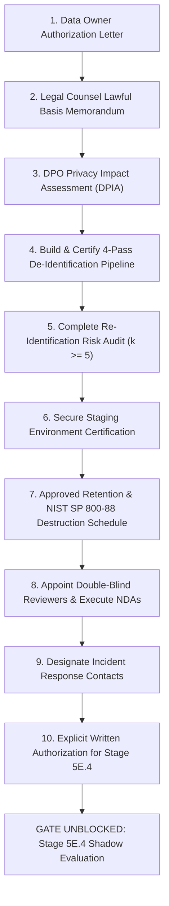

# TalentAI — Stage 5E.4.0: Real-Data Validation Readiness and Authorization Gate Report

**Project:** TalentAI — AI Resume Shortlister  
**Stage:** 5E.4.0 (Real-Data Validation Readiness and Authorization Gate)  
**Date:** 2026-10-31  
**Mode:** Read-Only Readiness Audit; Documentation Only  
**Overall Readiness Gate Decision:** **BLOCKED — PREREQUISITES PENDING**  
**Execution Authority:** Pre-Release Validation Governance  
**Strict Safety Invariant:** Zero access, reading, parsing, or processing of real resumes or candidate records. MongoDB instance, database `talent_ai`, collection `resumes`, and active batch `07281a64-46cf-46b4-a5c1-a0d46b13e7b2` remain completely untouched. Feature flag `USE_EVIDENCE_BASED_EXPERIENCE=False` strictly preserved.

---

## 1. Executive Summary & Gate Decision

In accordance with the Pre-Release Validation Governance Framework, a strict, read-only readiness audit was conducted to determine whether the mandatory prerequisites established in Stage 5E.3.4 ([stage_5e3_4_real_data_privacy_governance_authorization_protocol.md](file:///c:/Users/siddh/OneDrive/Desktop/Talent_AI/tests/pilot/stage_5e3_4_real_data_privacy_governance_authorization_protocol.md)) have been satisfied.

### Gate Evaluation Outcome:
- **Total Prerequisites Audited:** 10
- **Verified Satisfied:** 0 (0%)
- **Pending (Evidence Absent):** 10 (100%)
- **Unverifiable:** 0 (0%)
- **Overall Gate Status:** **BLOCKED — PREREQUISITES PENDING**

> [!CRITICAL]
> **Real-Data Processing Prohibited**  
> Because all 10 mandatory governance, legal, privacy, and technical prerequisites remain **Pending**, the project is strictly blocked from advancing to real-data validation or initiating Stage 5E.4.  
> No real resumes or candidate data may be accessed, uploaded, parsed, or processed. Evidence-based experience scoring remains behind the feature flag (`USE_EVIDENCE_BASED_EXPERIENCE=False`).

---

## 2. Audit Scope, Methodology & Operational Constraints

### 2.1 Audit Scope
The audit examined all configuration files, repository documentation, pilot artifacts, test suites, and environmental declarations within the workspace (`C:\Users\siddh\OneDrive\Desktop\Talent_AI`) to identify any documentary evidence satisfying the 10 prerequisites specified in Section 12 of the Stage 5E.3.4 Governance Protocol.

### 2.2 Evidentiary Standards & Classification Rules
Each prerequisite was independently evaluated and classified into exactly one of three rigorous states:
1. **Verified satisfied:** Explicit, verified documentary evidence (e.g., signed authorization, approved legal memorandum, formal DPIA, empirical certification report) exists in the repository.
2. **Pending:** The required approval, legal determination, or certification is absent from the repository.
3. **Unverifiable:** The evidence cannot be inspected or validated within the authorized read-only workspace scope.

**Strict Evidentiary Rules Applied:**
- Approvals cannot be inferred from source code comments, variable names, system configurations, or prior AI assistant status summaries.
- No legal compliance, consent grant, data-owner sign-off, or security certification may be claimed without explicit supporting documentation.
- Real candidate files or storage directories (`data/resumes/`) were **not** accessed or inspected. De-identification and privacy controls were **not** tested on live data.

---

## 3. Prerequisite Status Table (10-Item Audit)

| # | Prerequisite Item | Required Documentary Evidence | Verification Authority | Audit Classification | Audit Finding & Evidence Summary |
| :---: | :--- | :--- | :--- | :---: | :--- |
| **1** | **Data Owner Authorization** | Written authorization letter specifying cohort size ($N \le 300$), approved purpose, and permitted dates. | Data Owner / HR Executive | **Pending** | No written authorization letter, data use agreement, or formal charter from a designated Data Owner or HR Executive exists in the repository. |
| **2** | **Lawful Basis Confirmation** | Legal memorandum confirming GDPR, CCPA/CPRA, NYC Local Law 144, or local employment law processing basis. | Organizational Legal Counsel | **Pending** | No legal memorandum, regulatory opinion, or counsel sign-off addressing lawful processing basis exists in the repository. |
| **3** | **Privacy Impact Assessment (DPIA)** | Completed and formally approved Data Protection Impact Assessment (DPIA). | Data Protection Officer (DPO) | **Pending** | No completed or signed DPIA / PIA document assessing automated candidate processing risks exists in the repository. |
| **4** | **De-Identification Validation** | Empirical certification of 4-pass de-identification pipeline with zero residual PII on sample resumes. | Privacy / Security Lead | **Pending** | No certified 4-pass de-identification toolchain exists in the codebase; no empirical validation report or zero-PII test artifact exists. |
| **5** | **Re-Identification Risk Audit** | Formal risk assessment report certifying acceptable low re-identification risk ($k \ge 5$). | Privacy Engineer / DPO | **Pending** | No formal re-identification risk audit, linkage attack assessment, or $k$-anonymity certification exists in the repository. |
| **6** | **Storage & Environment Security** | Security verification certifying a dedicated, air-gapped, AES-256 encrypted environment with zero egress. | Systems / DevOps Security | **Pending** | No security certification or DevOps audit report verifying environment isolation, AES-256 encryption at rest, or air-gap egress controls exists. |
| **7** | **Retention & Destruction Schedule** | Formal schedule specifying exact research retention window and NIST SP 800-88 cryptographic wipe procedure. | Data Owner & Legal Counsel | **Pending** | While production batches have an ephemeral 24h cleanup (`RetentionService`), no formal legal retention schedule or NIST SP 800-88 destruction procedure exists for evaluation data. |
| **8** | **Reviewer Panel & Protocol Sign-Off** | Appointment of qualified double-blind reviewers; signed reviewer independence and confidentiality agreements. | Engineering / Talent Lead | **Pending** | No reviewer appointment charter, panel qualifications log, or executed confidentiality agreements exist in the repository. |
| **9** | **Incident Escalation Designation** | Formally documented primary and secondary emergency contacts for privacy and security incidents. | Executive Leadership | **Pending** | No named primary/secondary emergency escalation contacts or incident response escalation channels are designated in repository configuration. |
| **10** | **Explicit Stage 5E.4 User Authorization** | Formal written instruction from project user authorizing progression to Stage 5E.4. | Project User / Stakeholder | **Pending** | Prompt explicitly establishes Stage 5E.4.0 as a read-only audit and forbids treating it as approval to process real data or advance to Stage 5E.4. |

---

## 4. Granular Analysis of Pending Requirements

### 4.1 Governance & Legal Prerequisites (Items 1, 2, 3)
- **Item 1 (Data Owner Authorization):**
  - *Evidence Needed:* A formal document signed by an authorized Data Owner (e.g., Head of Talent Acquisition or HR Director) granting permission to evaluate up to 300 resumes solely for offline research.
  - *Authority Required:* Data Owner / HR Executive.
  - *Status:* **Pending**. No such document exists.
- **Item 2 (Lawful Basis Confirmation):**
  - *Evidence Needed:* A formal legal memorandum specifying the statutory legal ground (e.g., explicit candidate consent under GDPR Art. 6/9, Legitimate Interests Assessment, or jurisdiction-specific employment testing authorization).
  - *Authority Required:* Organizational Legal Counsel.
  - *Status:* **Pending**. No legal analysis or memorandum has been authored or archived in the project.
- **Item 3 (Privacy Impact Assessment - DPIA):**
  - *Evidence Needed:* A formal DPIA document analyzing privacy risks associated with candidate text extraction, automated experience scoring, and potential re-identification.
  - *Authority Required:* Designated Data Protection Officer (DPO) or Corporate Privacy Counsel.
  - *Status:* **Pending**. No DPIA has been conducted or approved.

### 4.2 Technical Privacy & Security Prerequisites (Items 4, 5, 6, 7)
- **Item 4 (De-Identification Validation):**
  - *Evidence Needed:* An automated test suite and signed certification report demonstrating that a 4-pass de-identification pipeline strips 100% of direct and indirect personal identifiers without data leakage.
  - *Authority Required:* Privacy / AppSec Lead.
  - *Status:* **Pending**. TalentAI's codebase currently contains regex resilience tests for logging (`test_ollama_resilience.py`), but does not contain a certified multi-pass de-identification engine for candidate resume text.
- **Item 5 (Re-Identification Risk Audit):**
  - *Evidence Needed:* A quantitative privacy risk audit certifying that quasi-identifiers (such as distinctive tenure combinations, specialized domain experience, and patent references) achieve a minimum $k$-anonymity threshold ($k \ge 5$).
  - *Authority Required:* Privacy Engineer / DPO.
  - *Status:* **Pending**. No risk audit or $k$-anonymity evaluation has been performed.
- **Item 6 (Storage & Environment Security):**
  - *Evidence Needed:* A systems architecture attestation certifying that evaluation execution occurs on an air-gapped machine or isolated environment with zero outbound network egress and AES-256 volume encryption.
  - *Authority Required:* Systems / Infrastructure Security Lead.
  - *Status:* **Pending**. The current local developer environment has not been hardened or formally certified for air-gapped evaluation.
- **Item 7 (Retention & Destruction Schedule):**
  - *Evidence Needed:* A legally binding data retention agreement specifying the exact calendar duration for research data retention and a NIST SP 800-88 Rev. 1 cryptographic erasure workflow.
  - *Authority Required:* Data Owner & Legal Counsel.
  - *Status:* **Pending**. While `RetentionService` exists for production batch TTLs (24 hours in `backend/.env`), no legally binding research data lifecycle schedule or certificate of destruction protocol exists.

### 4.3 Human Evaluation & Authorization Prerequisites (Items 8, 9, 10)
- **Item 8 (Reviewer Panel & Protocol Sign-Off):**
  - *Evidence Needed:* A list of qualified, designated technical evaluators ($\ge 5$ years domain experience) and signed double-blind confidentiality agreements.
  - *Authority Required:* Engineering / Talent Acquisition Leadership.
  - *Status:* **Pending**. No human evaluation panel has been chartered or appointed.
- **Item 9 (Incident Escalation Designation):**
  - *Evidence Needed:* Formal designation of emergency incident response contacts (name, title, contact channel) for security or privacy events.
  - *Authority Required:* Executive Leadership.
  - *Status:* **Pending**. No named contacts or incident response channels are documented.
- **Item 10 (Explicit Stage 5E.4 User Authorization):**
  - *Evidence Needed:* Written authorization from the project user explicitly commissioning Stage 5E.4.
  - *Authority Required:* Project User / Stakeholder.
  - *Status:* **Pending**. The user's directive for Stage 5E.4.0 explicitly states: *"Do not treat this prompt as approval to process real data. Start real-data validation or any later sub-stage."*

---

## 5. Overall Readiness Decision & Operational Impact

### 5.1 Official Gate Decision
```
+-------------------------------------------------------------+
|                                                             |
|       STAGE 5E.4.0 READINESS AND AUTHORIZATION GATE         |
|                                                             |
|       FINAL STATUS: BLOCKED -- PREREQUISITES PENDING        |
|                                                             |
+-------------------------------------------------------------+
```

### 5.2 Operational Impact & Restrictions
1. **Real-Data Validation Cannot Proceed:** Stage 5E.4 (Authorized De-Identified Shadow Evaluation) cannot be initiated.
2. **Zero Access to Real Data:** All developer, test, and evaluation activities must remain strictly isolated from real resumes, candidate files, and production database records.
3. **Feature Flag Invariant:** The feature flag `USE_EVIDENCE_BASED_EXPERIENCE` must remain `False`.
4. **Current Validation State:** TalentAI's validated baseline remains the **Stage 5E.3.3 Broad Synthetic Suite (PASS)**, which is sufficient for algorithmic verification on synthetic data, but not authorized for real-data deployment.

---

## 6. Exact Next Action Required to Unblock

To transition the readiness gate from **BLOCKED** to **READY FOR EXPLICIT AUTHORIZATION REVIEW**, the project stakeholder and organization must coordinate the following sequential actions:



### Responsible Authorities & Deliverables Needed:
1. **Executive Leadership / Data Owner:** Issue formal written authorization defining permitted cohort size ($N \le 300$) and dates.
2. **Organizational Legal Counsel:** Author legal memorandum confirming lawful basis for research processing and approve data retention/destruction terms.
3. **Data Protection Officer (DPO):** Conduct and approve formal DPIA and re-identification risk assessment.
4. **Security / Engineering Leads:** Implement and test 4-pass de-identification on synthetic test files; certify isolated air-gapped evaluation environment; charter double-blind reviewer panel.
5. **Project Stakeholder:** Upon receiving all 9 prerequisite deliverables, provide explicit written authorization to initiate Stage 5E.4.

---

## 7. Mandatory Safety & Compliance Confirmations

The following safety and compliance invariants are explicitly confirmed:

- **No Real Data Accessed or Processed:** Zero real resumes, candidate records, or personal identifying data were read, parsed, vectorized, or processed during Stage 5E.4.0.
- **Production Systems & Settings Unchanged:** No production code in `backend/app/` or `frontend/src/`, schemas, scoring formulas, weights, thresholds, or configuration files were modified.
- **Database & Batches Untouched:** MongoDB instance, database `talent_ai`, collection `resumes`, and active protected batch `07281a64-46cf-46b4-a5c1-a0d46b13e7b2` were not accessed or modified.
- **Backup Directory Intact:** Protected backup directory `backup_pre_reset_20261028` remains 100% untouched.
- **Feature Flag Posture:** Verified via read-only inspection of `backend/app/ranking/ranking_config.py` and `backend/.env` that `USE_EVIDENCE_BASED_EXPERIENCE = False` remains strictly unchanged.
- **No Advancement Beyond Stage 5E.4.0:** Stage 5E.4.1 or subsequent real-data validation activities have not been initiated.

---

## 8. Final Status & Stop Declaration

- **Stage Status:** **COMPLETE (AUDIT DELIVERABLE GENERATED)**
- **Gate Status:** **BLOCKED — PREREQUISITES PENDING**
- **Action Taken:** Execution stopped immediately following report generation. Awaiting user review and explicit instructions.
